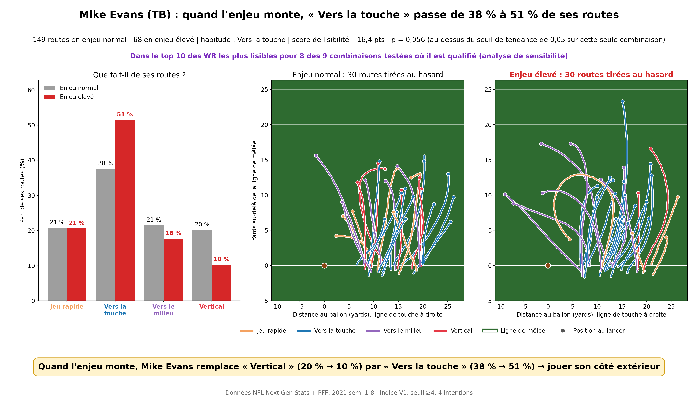
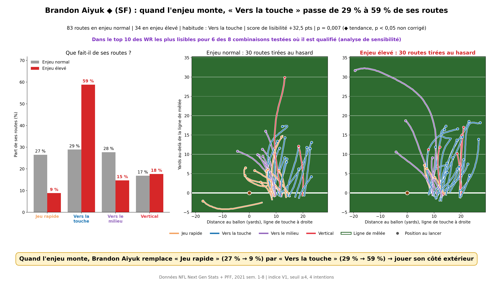
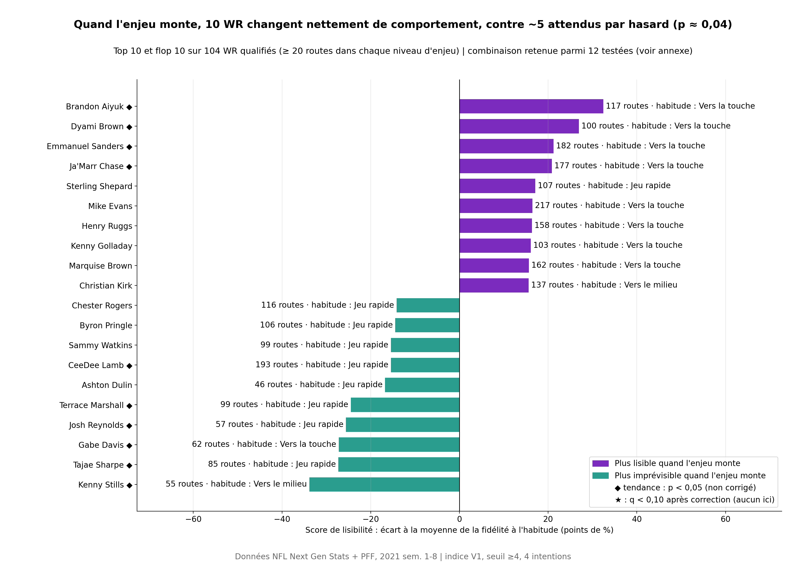
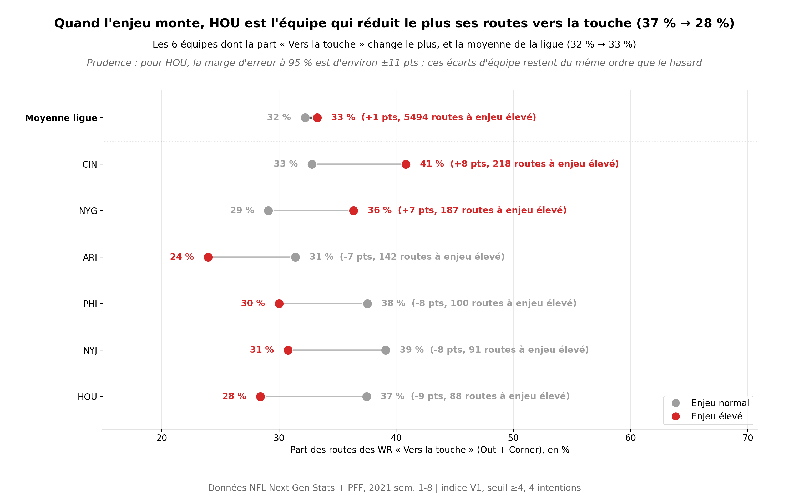
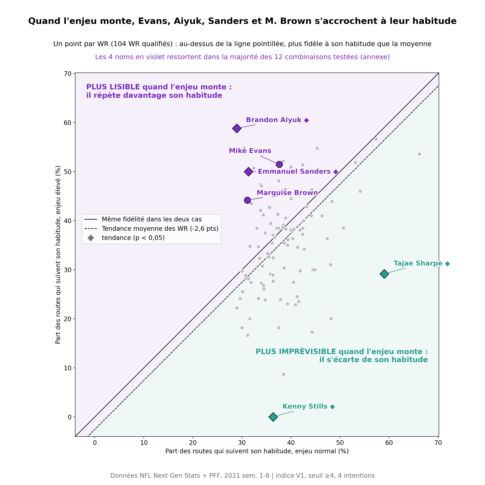
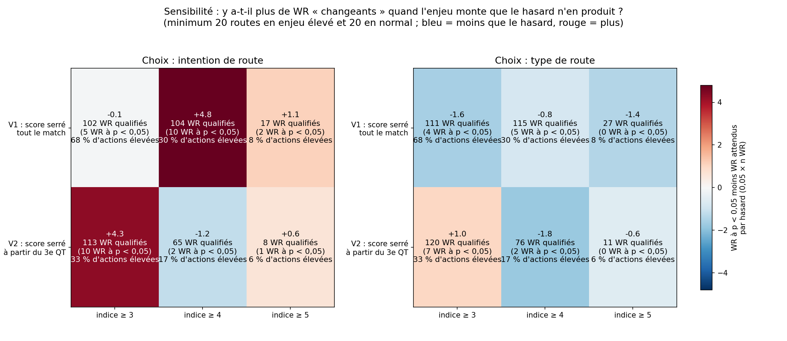

# Les receveurs deviennent-ils lisibles quand l'enjeu monte ?

On a classé les 20 415 routes de 209 wide receivers (saison 2021, semaines 1 à 8) à partir du tracking, en 4 intentions (jeu rapide, vers la touche, vers le milieu, vertical). On a ensuite mesuré, pour chaque WR, s'il répète davantage son intention habituelle quand l'enjeu monte (3e/4e tentative, fin de match, score serré, zone rouge). Sur 104 WR qualifiés, 10 changent nettement de comportement (p < 0,05), contre environ 5 attendus par hasard (test binomial p ≈ 0,04). Aucun ne passe la correction de Benjamini-Hochberg : ce sont des tendances, pas des preuves individuelles. Le profil le plus robuste est « davantage de routes vers la touche quand l'enjeu monte » : Mike Evans (38 % → 51 %), Brandon Aiyuk (29 % → 59 %), Emmanuel Sanders et Marquise Brown sont dans le top 10 des plus lisibles dans 6 à 8 des combinaisons testées où ils sont qualifiés. L'outil s'adresse à un coordinateur défensif (fiche de tendance par joueur) et à un commentateur TV (classement « qui devient lisible quand l'enjeu monte »).

## Résultats

Combinaison de base : indice V1, seuil ≥4, 4 intentions. Sur les 12 combinaisons testées (annexe), les classements individuels varient, mais Mike Evans, Brandon Aiyuk, Emmanuel Sanders et Marquise Brown ressortent dans la majorité d'entre elles.



Mike Evans est le WR le plus régulier de l'analyse (top 10 des plus lisibles dans 8 des 9 combinaisons où il est qualifié) : quand l'enjeu monte, il remplace ses routes verticales (20 % → 10 %) par des routes vers la touche (38 % → 51 %). Sur la seule combinaison de base, son p vaut 0,056.



Brandon Aiyuk ◆ (p = 0,007) montre l'écart le plus fort : « Jeu rapide » passe de 27 % à 9 % de ses routes, et « Vers la touche » de 29 % à 59 %.



10 WR sur 104 ont p < 0,05, contre environ 5 attendus par hasard : l'effet existe collectivement, mais aucun nom ne résiste seul à la correction de Benjamini-Hochberg.



Côté équipes, HOU est celle qui réduit le plus ses routes vers la touche (37 % → 28 %) et CIN celle qui les augmente le plus (33 % → 41 %). La marge d'erreur (environ ±11 pts) reste toutefois du même ordre que ces écarts, et la ligue bouge à peine (32 % → 33 %).



La plupart des WR restent proches de la tendance moyenne. Les quatre WR robustes se détachent nettement au-dessus ; Tajae Sharpe ◆ et Kenny Stills ◆ se détachent nettement en dessous.



Annexe : sur les 12 combinaisons, l'excès de WR à p < 0,05 n'apparaît nettement qu'avec les 4 intentions (V1 ≥4 : +4,8 ; V2 ≥3 : +4,3). Avec les 9 types de routes, il n'y en a pas plus que ce que le hasard produit.

### Annexe : analyses intermédiaires (9 types de routes, minimum 30/30)

Ces graphiques ont été produits avant le choix de la combinaison de base et suivent l'ancienne convention (★ pour p < 0,05 non corrigé) : [nuage](outputs/nuage_habitude.png), [classement](outputs/classement.png), [position par rapport au marqueur](outputs/nuage_habitude_vs_marqueur.png) et [son classement](outputs/classement_vs_marqueur.png), [fiche CeeDee Lamb](outputs/fiche_CeeDee_Lamb.png), [fiche Tyler Lockett](outputs/fiche_Tyler_Lockett.png). Le contrôle visuel de la classification des routes (10 matchs, 5 routes par type) est dans [grille_routes.png](outputs/grille_routes.png).

## Définitions

- **Indice d'enjeu V1** (infos d'avant le snap) : +1 si 3e tentative, +2 si 4e ; +1 si yardsToGo ≥ 7 ; +1 au 4e quart-temps ou en prolongation ; +2 si l'écart de score est ≤ 8 points ; +1 s'il reste ≤ 2 minutes dans la mi-temps ; +1 en zone rouge (≤ 20 yards de l'en-but). **Enjeu élevé = indice ≥ 4**, soit 30,0 % des actions avec lancer. La variante V2 n'accorde le +2 du score serré qu'à partir du 3e quart-temps.
- **Intentions** : Jeu rapide = Flat/Screen + Slant + Retour ; Vers la touche = Out + Corner ; Vers le milieu = In/Dig + Post ; Vertical = Go ; les routes « Autre » (14 %) sont exclues.
- **WR qualifié** : au moins 20 routes en enjeu élevé et 20 en enjeu normal (104 WR dans la combinaison de base).
- **Habitude** : l'intention la plus fréquente d'un WR en enjeu normal. **Taux d'habitude** : part de ses routes avec cette intention, en enjeu normal puis en enjeu élevé.
- **Score de lisibilité** : (taux élevé − taux normal) − moyenne de cette variation sur tous les WR qualifiés. Positif = plus lisible que la moyenne quand l'enjeu monte.
- **◆ tendance** : p < 0,05 au test de permutation (1 000 tirages des étiquettes d'enjeu au sein du joueur, habitude recalculée à chaque tirage), sans correction pour tests multiples. **★** : q < 0,10 après correction de Benjamini-Hochberg (aucun WR).
- **Types de routes** (règles V3, première règle vraie) : Flat/Screen (profondeur max < 3 yd), Retour (recul ≥ 1 yd ou vitesse < 2,5 yd/s au lancer), Slant, Out, In/Dig, Go, Post, Corner, Autre, selon la profondeur max et le déplacement latéral (positif vers l'extérieur).

## Hypothèses et limites

- **Choix de la combinaison** : la combinaison de base a été fixée après l'analyse de sensibilité, et c'est l'une des deux où l'excès de WR à p < 0,05 est le plus net. Le test binomial (p ≈ 0,04) ne tient pas compte de ce choix fait après avoir vu les données. Le résultat solide est la stabilité des quatre noms d'une combinaison à l'autre, pas le nombre de WR à p < 0,05.
- **Regroupement des routes** : il peut inverser un résultat. Dyami Brown ressort parmi les plus lisibles avec les 4 intentions (+27 pts) et parmi les plus imprévisibles avec les 9 types (−20 pts), à indice et seuil identiques.
- **Route mesurée au lancer** : le tracking s'arrête environ 0,5 s après la passe, donc une route pas encore cassée au moment du lancer est classée d'après son début. Les releases vers l'extérieur gonflent « Vers la touche ».
- **Effet de situation** : les 43 WR dont l'habitude est « Vers la touche » ont un score moyen de +4,2 pts, contre −2,4 pour les 55 WR « Jeu rapide ». Le score mélange donc en partie le joueur et ce que les situations à enjeu appellent.
- **Échantillons** : de 20 à 120 routes à enjeu élevé par WR. Une ◆ mérite d'être vérifiée en vidéo avant d'en faire une consigne.
- **Biais de construction** : l'habitude est choisie sur l'échantillon normal, donc son taux normal est gonflé (tendance moyenne −2,6 pts). Le centrage du score et le test de permutation corrigent ce biais.
- Le modèle prédictif bonus (04_model.py) n'a pas été réalisé.

## Comment lancer

1. Télécharger les données depuis https://github.com/ThompsonJamesBliss/nfl-big-data-bowl-regional-event-data dans `data/` (games.csv, plays.csv, players.csv, pffScoutingData.csv et `tracking/` avec les 122 fichiers).
2. `pip install pandas numpy matplotlib scikit-learn scipy`
3. Lancer dans l'ordre :

```
py 01_build_plays.py
py 02_extract_routes.py --echantillon
py 02_extract_routes.py
py 03_habitude.py
py 05_viz.py
py 06_cas_usage.py
py 07_sensibilite.py
py 08_final.py
```

Les résultats sont écrits dans `outputs/` : `outputs/sensibilite/` pour l'analyse de sensibilité, `outputs/final/` pour les visuels finaux. L'ensemble prend environ 2 minutes.

Démo interactive : py -m streamlit run app.py (après `py -m pip install streamlit plotly`).
